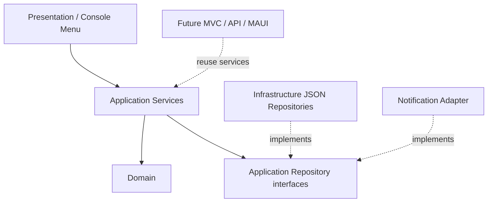

# Design

- **Single project with modular folders:** avoids a `src` folder and keeps Week 1 easy to open and run, while maintaining boundaries for later extraction.
- **Allocation is independent:** stores employee, project, dates and percentage.
- **Employment type enum:** classifications currently have no unique behavior.
- **Repository abstraction:** storage can later change from JSON to EF Core.
- **Matching strategy:** `IMatchingStrategy` isolates skill scoring.
- **Composition root:** dependency registrations are in `Program.cs`; menu and seed logic live in separate classes.
- **Error handling:** expected allocation failures return `OperationResult`; invalid domain data throws argument exceptions.

## SOLID
- **SRP:** separate domain, application services, persistence, notifications and console UI.
- **OCP:** new matching strategies/storage adapters can be added.
- **LSP:** alternative repositories can implement the same contract.
- **ISP:** separate repository interfaces for employees, projects and allocations.
- **DIP:** application service uses interfaces rather than JSON implementations.

The included unit tests cover date overlap and skill matching. Run `dotnet build` and `dotnet test` locally to verify with your installed .NET 10 SDK.
